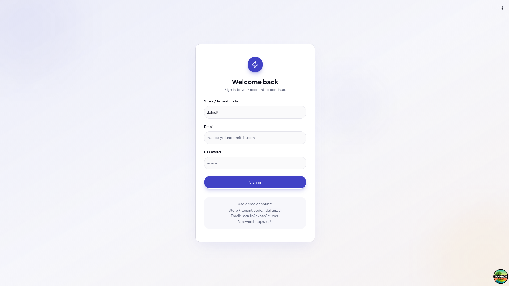
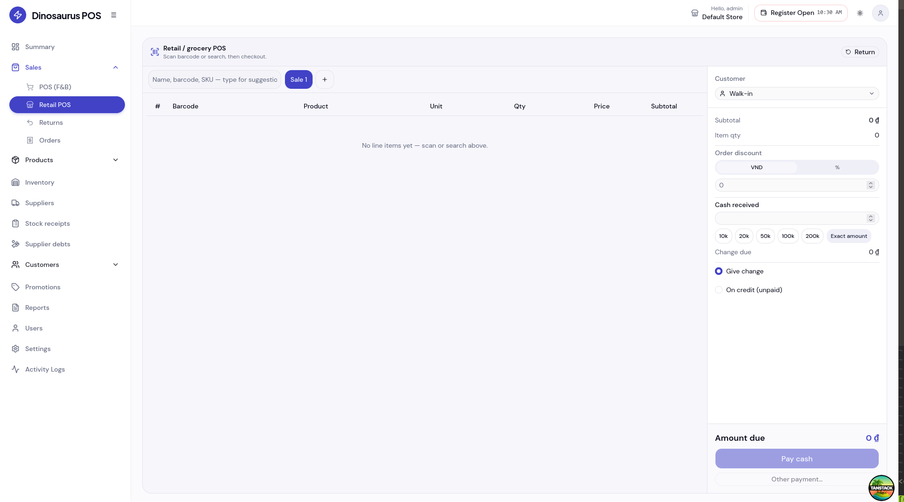
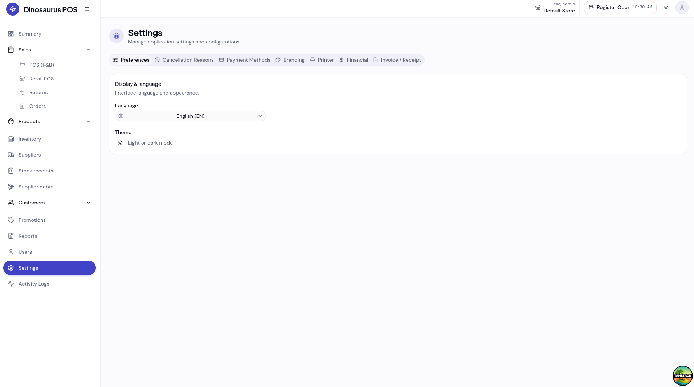
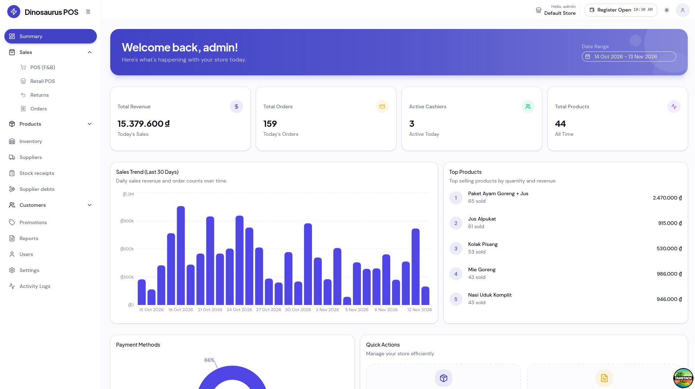
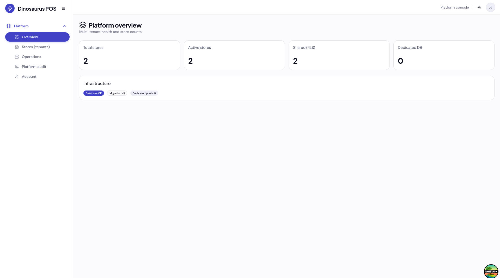

# Dinosaurus POS

[](https://github.com/thanhtai9606/dinosaurus-pos/actions/workflows/ci-cd.yml)


Modern, multi-tenant Point of Sale for retail: inventory, checkout, shifts, supplier/customer debt ledgers, stock receipts, and analytics. The Go backend serves the REST API and the React SPA on a single port (`8080`).

**Contributing?** See [docs/CONTEXT.md](docs/CONTEXT.md) for domain flows (stock receipts, debts, RBAC, file map). Cursor loads a short summary from `.cursor/rules/project-domain-context.mdc` — keep both updated when you add major features.

| | |
|---|---|
| **GitHub (development)** | https://github.com/thanhtai9606/dinosaurus-pos |
| **Lineage (Go + React POS)** | https://github.com/agpprastyo/dinosaurus-pos · https://github.com/agpprastyo/POS-kasir |
| **Reference demo (upstream)** | https://pos-kasir.agprastyo.me |

---

## Overview

**Dinosaurus POS** is a full-stack POS application: products and categories, retail checkout, payments (including Midtrans), cashier shifts, promotions, reports, thermal printing, and **PostgreSQL row-level security** per tenant.

It evolved from **[POS-kasir](https://github.com/agpprastyo/POS-kasir)** / **[dinosaurus-pos](https://github.com/agpprastyo/dinosaurus-pos)** (Go + Fiber + React) and also draws on UX and architecture ideas from **[poinf-of-sales](https://github.com/madebyaris/poinf-of-sales)** (Go, React, TypeScript, PostgreSQL).

Single-port deployment: build the SPA into `web/dist/` and the Go server serves `/api/v1/*`, Swagger, and static frontend assets.

### Key capabilities

| Area | Highlights |
|------|------------|
| **Auth & tenants** | JWT, RBAC (super admin / admin / manager / cashier), `tenant_code` login, tenant switch |
| **Catalog** | Products, product groups, measurement units, sale units & conversions, price lists (Excel) |
| **Inventory** | Stock receipts, suppliers, soft-delete products, images (R2/MinIO) |
| **Sales** | Orders, retail POS, customers, customer groups, promotions |
| **Finance** | Supplier & customer debt ledgers, partial payments |
| **Ops** | Shifts, cash reconcile, activity logs, reports, ESC/POS & network printer discovery |
| **Platform** | Super admin tenants, demo catalog seed by market/vertical, i18n (vi/en/id) |

---

## Local / demo quick reference

### Demo accounts (after `make seed` or `make db-reset`)

Shared password: **`1q2w3E*`**  
Default tenant code: **`default`**

| Role | Email | Username | Notes |
|------|-------|----------|--------|
| Super admin | `superadmin@example.com` | `superadmin` | Tenants, `POST /api/v1/tenants`, switch store in UI |
| Admin | `admin@example.com` | `admin` | Users & settings in current tenant |
| Manager | `manager@example.com` | `manager` | Products, reports, configuration |
| Cashier | `cashier@example.com` | `cashier` | POS, orders, shifts |

`make create-demo-users` re-runs the user seeder and prints this table.

### Sign-in

1. **Store code (tenant)** — e.g. `default`
2. **Email** and **password**

API: `POST /api/v1/auth/login` with `{ "tenant_code", "email", "password" }`. The JWT carries `tenant_id`; effective role is `super_admin` or the membership role on `tenant_users`.

### Multi-tenant (short)

| Item | Value |
|------|--------|
| Default tenant | UUID `00000000-0000-0000-0000-000000000001`, code **`default`** |
| Switch tenant (logged in) | `POST /api/v1/auth/switch-tenant` or sidebar **tenant switcher** |
| My tenants | `GET /api/v1/tenants/mine` |
| Create tenant | **Super admin** — `POST /api/v1/tenants` |
| Dedicated DB / backup | [docs/MULTITENANT_OPS.md](docs/MULTITENANT_OPS.md) |

Business data is isolated per tenant (PostgreSQL RLS). Enterprise tier can use separate databases via `TENANT_DSN_*`.

### Currency & financial settings

Default currency after migrations: **VND (₫)**; IDR and USD can be enabled under **Settings → Financial**. UI amounts use `MoneyContext`, aligned with `GET /api/v1/settings/financial`.

### Database first run / reset

```bash
make dev-setup    # infra + migrate + seed
make migrate-up   # migrations only
make seed         # sample data
make db-reset     # drop public schema, migrate, seed (type YES)
```

Migrations live in `sqlc/migrations/`.

---

## Screenshots

| Admin login | Retail POS |
| :---: | :---: |
|  |  |

| Settings | Summary dashboard |
| :---: | :---: |
|  |  |

| Super admin (multi-tenant) |
| :---: |
|  |

---

## Tech stack

**Backend:** Go 1.25, Fiber v3, PostgreSQL 15, sqlc, Redis, JWT/RBAC, WebSocket, Swagger, ESC/POS.

**Frontend:** React 19, TanStack Router & Query, Vite 7, pnpm, Tailwind 4, shadcn/ui, OpenAPI client, react-i18next, Recharts.

**Infra:** Docker (multi-stage image), GitHub Actions CI/CD, MinIO/R2, Redis, optional Sentry.

### Architecture (simplified)

```
┌────────────────────────────────────────┐
│           Go backend :8080            │
│  /api/v1/*  /swagger/*  /* (SPA)      │
└───────┬─────────────┬──────────┬───────┘
        │             │          │
   PostgreSQL       Redis    MinIO/R2
```

---

## Quick start (Docker)

```bash
git clone https://github.com/thanhtai9606/dinosaurus-pos.git
cd dinosaurus-pos

cp .env.example .env
# Set DB_PASSWORD and JWT_SECRET

docker compose up -d

# App     → http://localhost:8080
# Swagger → http://localhost:8080/swagger/index.html
# MinIO   → http://localhost:9001
```

Required env (minimum): `DB_PASSWORD`, `JWT_SECRET` (`openssl rand -hex 32`). See [`.env.example`](.env.example) for the full list.

---

## Development setup

**Prerequisites:** Go 1.25+, Node 22+, pnpm 10+, PostgreSQL 15+, Redis, Docker.

```bash
make dev-setup        # first time: infra + migrate + seed
make dev              # infra + backend + frontend
make dev-backend      # API on :8080
make dev-frontend     # Vite on :5173 (proxies /api)
```

```bash
cd web && pnpm install && pnpm dev
```

**API errors from the UI?** Run `make dev` (backend + Vite). Postgres in Docker often uses `DB_PUBLISH_PORT` (default **5433**). `DB_PASSWORD` must match the volume you created.

```bash
cd web && pnpm build   # output: web/dist/
```

### Useful commands

`make help` for the full list. Common:

```bash
make up | make down           # infra only
make migrate-up | make seed
make sqlc-generate | make swag
make test                     # go test + web vitest
```

---

## Project structure

```
cmd/app/          Server entry
internal/         Domain modules (orders, products, tenants, debts, …)
server/           Routes, DI, SPA static files
sqlc/migrations/  Schema migrations
web/              React SPA (routes, components, lib/api)
```

---

## API documentation

- **Local:** http://localhost:8080/swagger/index.html  
- Regenerate: `make swag` (also refreshes the web OpenAPI client / RBAC rules when configured)

---

## CI/CD

GitHub Actions on push/PR to `master` and on semver tags. Typical flow: test → build image → deploy (see `.github/workflows/ci-cd.yml`). Pushing workflow changes requires a PAT with the **`workflow`** scope.

---

## License

[MIT License](LICENSE).

## Acknowledgments

| Project | Author | What we reused / learned |
|---------|--------|---------------------------|
| [POS-kasir](https://github.com/agpprastyo/POS-kasir) | [Agung Prasetyo](https://github.com/agpprastyo) | Core POS domain: Go (Fiber) API, React SPA, inventory, orders, Midtrans, reports, single-port serving |
| [dinosaurus-pos](https://github.com/agpprastyo/dinosaurus-pos) | Agung Prasetyo | Direct upstream fork base; module layout, sqlc, CI/CD, and feature set this repo extends |
| [poinf-of-sales](https://github.com/madebyaris/poinf-of-sales) | [madebyaris](https://github.com/madebyaris) | Reference for admin tables, RBAC-oriented UI, and PostgreSQL-backed enterprise POS patterns |

**This repository** ([thanhtai9606/dinosaurus-pos](https://github.com/thanhtai9606/dinosaurus-pos)) is maintained for continued development (GitLab `devops/dinosaurus-pos` + public GitHub). Additions here include multi-tenant RLS, stock receipts, supplier/customer debt ledgers, measurement units, market-based catalog seeding, and Vietnamese/English/Indonesian UI.

Please star and support the upstream projects if you find them useful.
